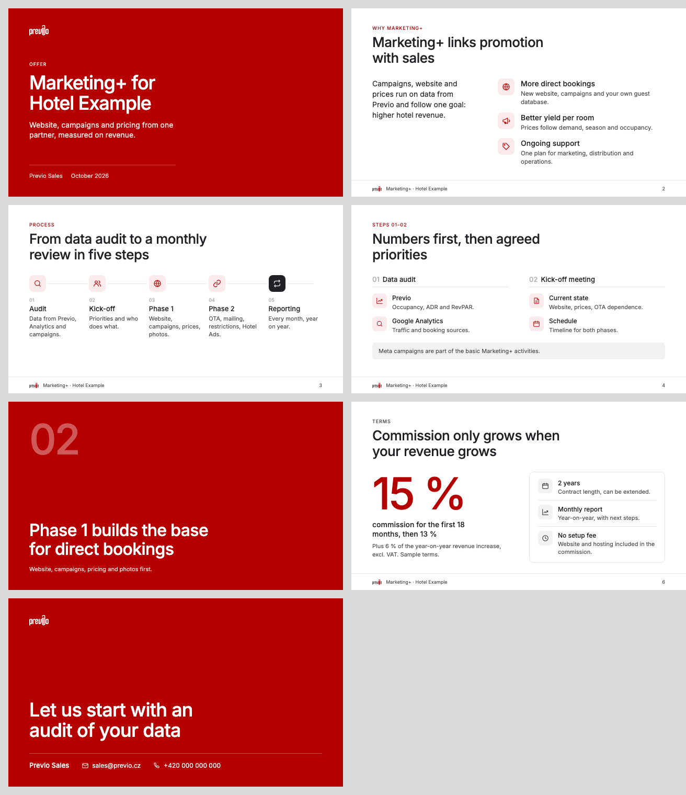
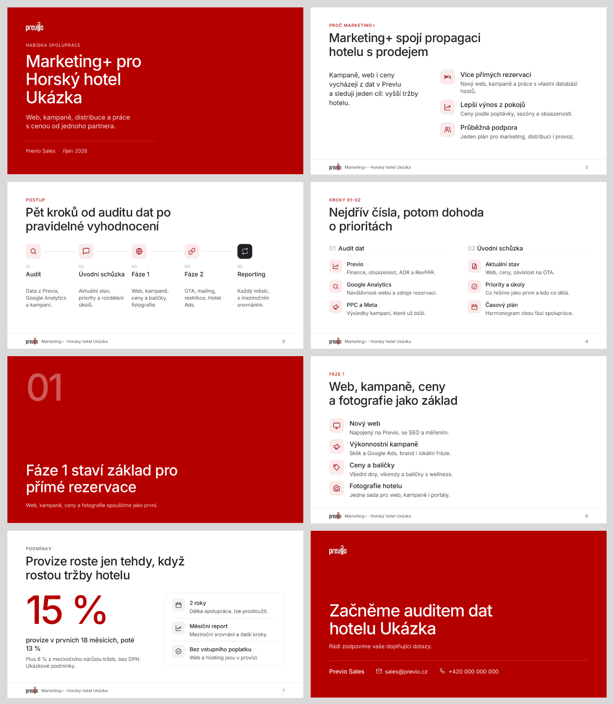
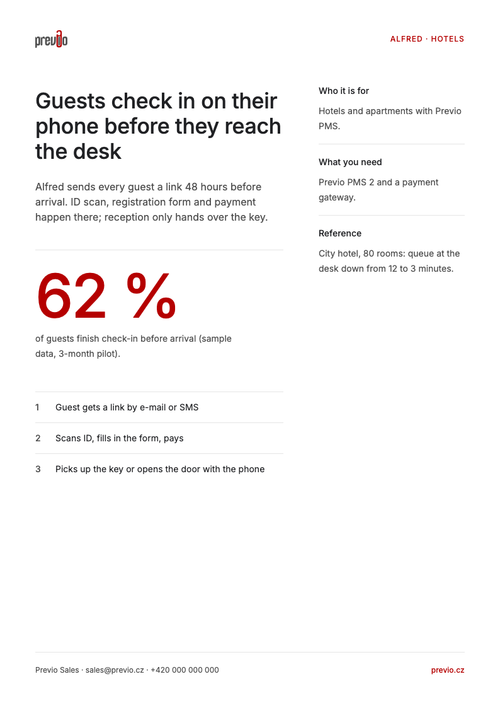
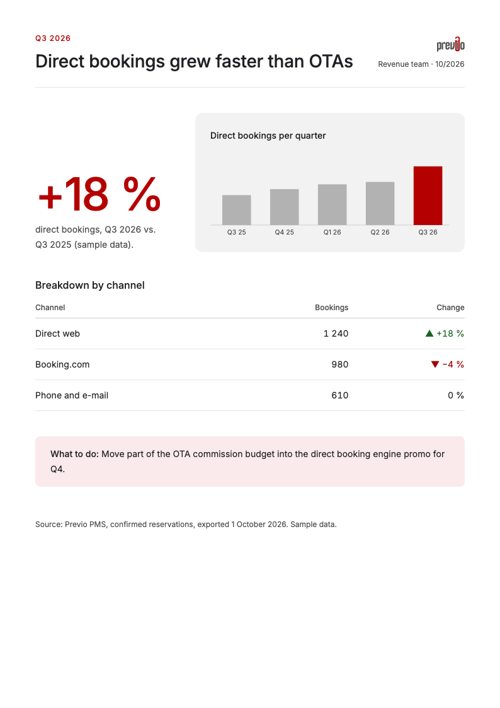
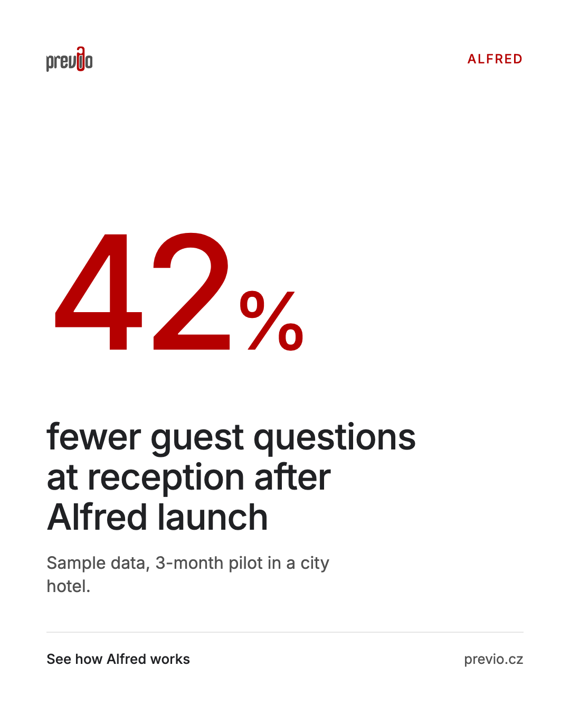
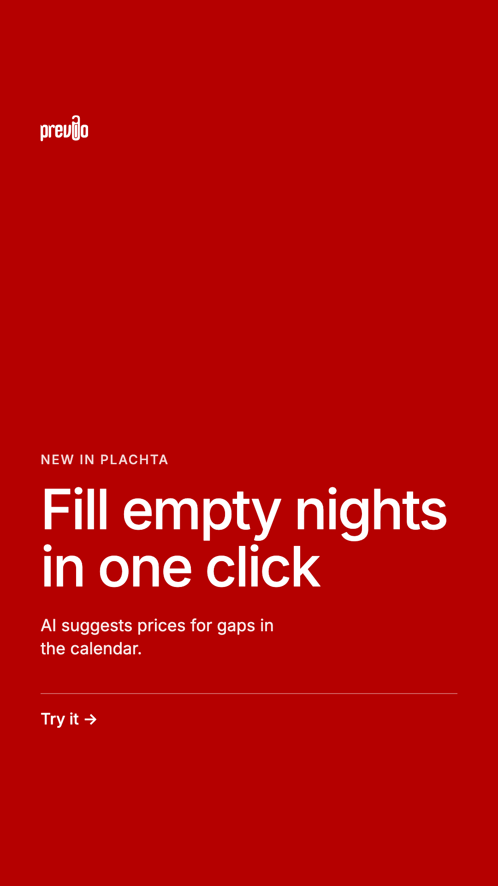
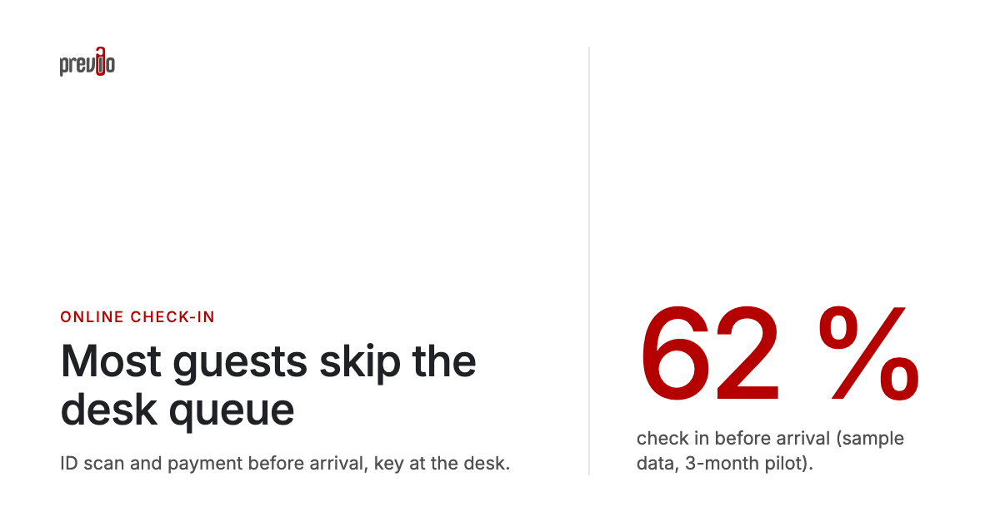

# previo-brand

A Claude skill that applies the official Previo brand (colors, typography, logo, composition rules)
to visual outputs: decks, PDFs, HTML reports and dashboards, one-pagers, social graphics. The values
come from the Previo design system in Figma (**P – design system**). The skill ships ready-made
templates, so most outputs start from a proven Previo layout.

**Download:** [previo-brand-v5.skill](https://github.com/paveltrnka-prog/previo-brand/releases/download/v5/previo-brand-v5.skill) (v5) · all versions in [Releases](https://github.com/paveltrnka-prog/previo-brand/releases)

## Install

- **Claude Desktop / claude.ai:** Settings → Capabilities → Skills → **Upload skill**, pick the
  `.skill` file, turn on **previo-brand**.
- **Claude Code:** unzip the package so that the folder `previo-brand/` (with `SKILL.md` inside)
  ends up in your Claude Code skills folder, then start a new session.

**Font for PowerPoint/Word:** HTML and PDF outputs carry Inter inside. To open `.pptx`/`.docx` with
the exact look, install `Inter-Regular.ttf` and `Inter-Medium.ttf` from the package's `fonts/`
folder once (Mac: double-click → Install Font; Windows: right-click → Install for all users).
Otherwise share PDFs.

## Use

Just ask; branding happens automatically:

| Ask | What you get |
|---|---|
| "One-pager about Alfred for hoteliers." | `templates/onepager.html`, fixed A4, one big number, facts beside it. |
| "Q3 report from these numbers." | `templates/report.html`: one main chart, table, recommendation. |
| "Instagram post with 42 %." | `social-feed.html`, 4:5, exported to PNG. |
| "Story for the campaign." | `social-story.html`, 9:16, full red, safe zones. |
| "LinkedIn image for an article." | `social-linkedin.html`, 1200 × 627 px. |
| "Client deck, 8 slides." | `.pptx` from the generator `scripts/build_deck.py`: fixed grid, red cover and closing, icons, text that fits, HTML preview. |
| "Show Alfred presenting a new feature." | The mascot `alfred/alfred.svg` next to the content, on a light background. |
| "Plachta mockup with reservation states." | State colors from `tokens.md`. |

Fine-tune in plain words: "less busy", "highlight just one number", "no purple".

## Examples

What the templates look like once Claude fills them in. Sample content, the numbers are
illustrative, not real Previo data.

<p><br><b>Deck template</b> · 16:9, all slide types of <code>templates/deck.html</code>: red cover and closing, icon list, process timeline, red statement slide, number hero with a gray label.</p>

<details>
<summary><b>A real sales deck as .pptx</b> (an actual offer rebuilt with <code>scripts/build_deck.py</code> from <code>scripts/deck-example.json</code>, rendered from the PowerPoint file; client, contact and terms anonymized)</summary>
<p></p>
<p>What the skill changed compared to the first version: red cover and closing instead of white, one red statement slide before phase 1,
an icon on every item instead of gray card grids and pill clouds, a gray label and gray icon tiles on the slide whose hero is the red
15&nbsp;%, one product name throughout, text 13&nbsp;pt and up with at most 5 items per slide, and hotel photos cropped instead of
stretched (photos left out of this public sample).</p>
</details>

<table>
  <tr>
    <td width="50%"><br><b>One-pager</b> · A4, one red number as the hero, facts beside it, steps only when sequential.</td>
    <td width="50%"><br><b>Report</b> · A4, one key number + one chart with the highlighted bar, table with signed changes, recommendation.</td>
  </tr>
</table>

<table>
  <tr>
    <td width="36%"><br><b>Feed 4:5</b> · 1080 × 1350 px.</td>
    <td width="28%"><br><b>Story 9:16</b> · 1080 × 1920 px, full red, app UI safe zones.</td>
    <td width="36%"><br><b>LinkedIn / OG</b> · 1200 × 627 px, claim + number.</td>
  </tr>
</table>

## Prompting tips

The skill fills in the brand by itself; the prompt decides the content. These make the biggest difference:

1. **Say what it is, for whom and how it will be used.** "Offer deck for the owner of a 60-room mountain
   hotel, sent as a PDF to read" gets other text sizes and density than "deck I will present at a
   conference" (projected: bigger text, max. 3 items per slide).
2. **Give the real material.** Numbers, prices, terms, dates, the presenter's name and contact, the
   client's name. Attach the source (old deck, brief, notes, export); Claude restructures it but does
   not invent facts. Missing facts come back as `{{placeholders}}`.
3. **Attach photos of the client's property** and say where they belong (cover, a product slide). They
   make a deck specific; the skill crops them, never stretches them.
4. **One message per slide, in your words.** List the slides as claims ("Commission grows only with
   revenue"), not topics ("Terms"). Say how many slides you want.
5. **Name the one number that matters.** "The hero is 15 % commission" tells Claude which slide gets the
   big red number; everything else stays quiet.
6. **Use one product name** and say it ("call it Marketing+, never M+"). Mixed names are the most common
   error in decks built from several sources.
7. **Say what is not included or must not be promised.** Exclusions in one place keep other slides from
   contradicting them.
8. **Ask for the check.** "Render every slide and run the check from deck-structure.md before you hand it
   over" catches overflowing text, squeezed photos and red used twice.
9. **Refine in plain words**, one slide at a time: "slide 6 is too dense, split it", "less red on slide 4",
   "swap the icon for a calendar".

Example:

```text
Make an offer deck (.pptx + PDF) for Hotel Example, 60 rooms, Beskydy. It will be sent by e-mail
and read, not presented. Product name: Marketing+ (never M+). Presenter: Jana Nováková,
jana.novakova@previo.cz, +420 000 000 000, date October 2026.
Slides: 1 why Marketing+ (more direct bookings, better yield, ongoing support), 2 five-step process,
3 phase 1 (web, Sklik + Google Ads, prices and packages, photos), 4 phase 2 (OTA, mailing, Hotel Ads),
5 monthly reporting, 6 terms: the hero is 15 % commission for 18 months, then 13 %; 2-year contract.
Meta/Facebook campaigns are NOT included. Use the attached lobby photo on the cover.
Render every slide and run the check before you hand it over.
```

## Color roles at a glance

| Color | Role |
|---|---|
| Red `#b50000` | The brand. One hero per page/slide (red area or biggest number) + small signals (section label, CTA, highlighted chart item). |
| Grays `#fafafa → #202124` | Everything else: text, surfaces, dividers, non-highlighted chart items. |
| AI purple `#673AB7` → `#4E2C8B` | AI features in the Previo product UI only. |
| Alfred plum `#6F2F6A` | The Alfred mascot and materials about the Alfred guest app only. |
| Semantic (positive/negative/warning) | State only, always with an icon. |

Full values in [`previo-brand/tokens.md`](previo-brand/tokens.md), rules in
[`previo-brand/SKILL.md`](previo-brand/SKILL.md).

## Feedback

Missing something? Claude writes a short feedback note when a request goes beyond the skill; send it
to the author. See [`CONTRIBUTING.md`](CONTRIBUTING.md).

## Structure

```
previo-brand/          the skill (this folder is what gets packaged)
├── SKILL.md           rules: when and how to apply the brand
├── tokens.md          values: colors, typography, radius, spacing, CSS variables
├── fonts/             Inter 400 + 500 (SIL OFL 1.1)
├── logo/              color / black / white SVG
├── icons/             line icons (SVG) + png/ in red / ink / white for .pptx
├── scripts/           build_deck.py: JSON outline → .pptx on the fixed grid (+ deck-example.json)
│                      check_deck.py: grid check of any .pptx + render to PNG via LibreOffice
├── alfred/            mascot + AI icon
└── templates/         self-contained HTML templates + deck-structure.md (generated, do not edit HTML)
tools/                 maintenance only, not part of the skill
├── src/               template sources (edit here)
├── build.py           builds templates/ from src/ (embeds font, logo, icons)
├── examples.py        renders the README examples into docs/examples/
└── icons.py           renders icons/png/ and logo/png/ from the SVGs (needs Google Chrome, macOS sips)
docs/examples/         README example images
```

## Maintenance (author)

1. Edit `tools/src/*.html`, then run `python3 tools/build.py` and `python3 tools/examples.py`
   (refreshes the example images; needs Google Chrome).
2. Package: `zip -r -X previo-brand-v5.skill previo-brand -x '.*'`.
3. Publish the `.skill` file as a GitHub Release with tag `vN` and update the download link at the
   top of this README. The package is a build artifact and is not committed (`.gitignore`).
   ```bash
   gh release create v5 previo-brand-v5.skill --title "previo-brand v5" --notes "…"
   ```

When the design system changes, update `tokens.md`; `SKILL.md` usually stays as is.

## Changelog

**v6**
- New `scripts/build_deck.py`: writes a `.pptx` from a JSON outline on one fixed grid (label, headline
  and content start at the same place on every slide), with an HTML preview. Measures text with the
  Inter metrics and refuses content that would overflow; checks the red rhythm; crops photos.
- New `scripts/check_deck.py`: checks any `.pptx` against the grid (positions, tile sizes, fonts,
  edges) and renders it to PNG through LibreOffice with Inter loaded.
- New slide type two columns with sub-headings (A/B, 01/02) and a `note` box, in `deck.html` and in
  the generator.
- Bigger icon tiles (0.5 in, icon 0.25 in); grid measurements in `deck-structure.md`.
- Logo PNGs for `.pptx` (`logo/png/`); footer logo 28 px instead of 20 px.
- Photos: new slide types full photo (`photo-full`) and gallery (2–3 photos); `focus` keeps the subject
  in view when cropping; `photo` can sit on the left; the generator warns about low-resolution photos
  and scales large ones down.

**v5**
- New `templates/deck.html`: 16:9 deck with red cover and closing, red statement slide, icon lists,
  process timeline and number hero; visual reference for `.pptx` and a ready HTML/PDF deck.
- Icon set `icons/` (27 line icons, SVG + PNG in red / ink / white) and icon tile rules.
- Decks are no longer gray: red rhythm (cover → content → statement → content → closing), white
  cards by default, no grids of identical gray cards or pill clouds.
- Photos: never stretched, always cropped (python-pptx `crop_*`).
- Text sizes for projected vs. read decks; one product name throughout; check-list before hand-over.
- `deck.html` text set to read-deck sizes (body 12 pt+).
- README: prompting tips and a real 12-slide sales deck as an example.

**v4**
- Skill translated to English; description says in three sentences what the skill is for.
- Environment-independent: no machine paths; fonts and logos are embedded into outputs (base64 /
  inline SVG) instead of linked relatively.
- Clear red rule: one hero per page/slide + small signals; decks gray the label when a red number is
  the hero.
- AI purple `#673AB7` (Previo product UI) vs. Alfred plum `#6F2F6A` (mascot, Alfred guest app),
  same values on screen and in print.
- One-pager is fixed A4; overflow is fixed by shortening content, never by stretching the page.
- `INSTALACE.md` removed (install notes are here); template sources and `build.py` moved out of the
  skill to `tools/`.
- New "feedback for the skill author" section instead of a GitHub contribution workflow.

**v3**
- AI purple, Alfred mascot and AI icon, Plachta state colors, HTML templates (one-pager, report,
  social feed/story/LinkedIn), deck structure.

**v2**
- Bundled Inter TTF, three logo variants, semantic colors, `.docx` boundary, anti-"AI slop"
  composition rules.
